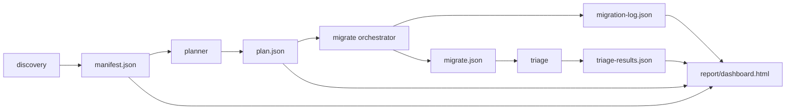
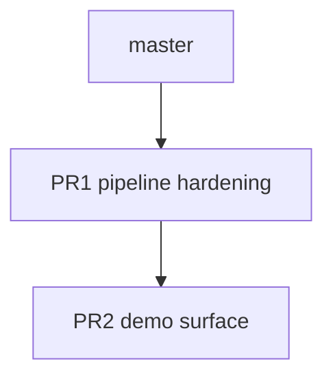

# Design: Demo Hardening for Moment → date-fns Pipeline

**Date:** 2026-07-16  
**Status:** Approved in brainstorming (Approach 1 + Q&A 1B–10B)  
**Repos under study:** `target-repo` (primary demo). `control-repo` remains a side experiment on `mutated-migration`.

## 1. Goal

Make the migration pipeline demo-ready by:

1. Adding three deliberately awkward Moment call sites to `target-repo`.
2. Implementing migrate-stage git guardrails with rollback logging.
3. Consolidating the dashboard into `pipeline/report/dashboard.html` fed by real pipeline JSON.
4. Scaffolding `DEMO_SCRIPT.md` with real commands and empty screenshot slots.

Success criteria:

- Discovery + planner refresh after the new call sites; characterize is **not** re-run for those sites.
- `SIMPLE_FORMAT` clusters auto-migrate in-repo; other clusters hand off to Codex (or stay pending).
- Failed cluster migrations never merge into the base branch; rollback command is printed and logged.
- Dashboard panels populate from real files only (no placeholder rows).
- Work ships as two stacked PRs: pipeline hardening, then demo surface.

## 2. Architecture



### Components

| Unit | Responsibility | Depends on |
|------|----------------|------------|
| `target-repo` awkward sites | Organic legacy call sites for demo failure modes | existing services/lib |
| `pipeline/discovery` | Refresh `manifest.json` | target-repo JS |
| `pipeline/planner` | Refresh ordered `plan.json` clusters | manifest |
| `pipeline/migrate` | Per-cluster branch, transform or handoff, test gate, merge or rollback, log | plan, characterize tests, git |
| `pipeline/triage` | Emit `triage-results.json` (verdicts + rationales) | migrate + optional Codex notes |
| `pipeline/report/dashboard.html` | Single SPA over canonical JSON | manifest, plan, migration-log, triage-results |
| `DEMO_SCRIPT.md` | Six-beat narrative with real commands | all of the above |

### Configurable base branch

- Env: `PIPELINE_BASE_BRANCH` (default: `master`).
- No rename of `master` → `main`.
- Rollback printout uses the configured base name.

## 3. Awkward call sites (Step 2)

Spread across the tree so they read as organic legacy code. **No dedicated tests or fixtures** for these three.

### 3.1 Ambiguous shared utility — `lib/dates.js`

- Add `normalizeBusinessDate(value, options)`.
- Uses Moment parse + optional start/end-of-day + locale-sensitive formatting.
- Called from both invoice and reporting paths.
- Discovery sees one utility; usage context is ambiguous across callers.
- Indirect coverage only via existing caller characterization tests (see §4.3a — not `skipped_unguarded`).

### 3.2 No behavioral evidence — `services/vendorExports.js` (new)

- Rarely touched quarterly vendor export helper.
- Moment-based fiscal period / vendor date string conversion.
- Exported but not wired into sample jobs or fixtures.
- Discovery finds it; characterize does not invent inputs; migrate treats it as unguarded (`skipped_unguarded` per §4.3a — no direct or indirect match).

### 3.3 Non-obvious mutation aliasing — `services/scheduler.js`

- Shared Moment instance mutated in place, then read through another reference downstream.
- Naïve immutable date-fns substitution that drops the returned value silently changes later fields.
- Intentionally untested (no direct characterization test for the aliasing path; coverage resolution per §4.3a).

### After adding sites

1. `npm run discovery` → refresh `pipeline/data/manifest.json`.
2. `npm run planner` → refresh `pipeline/data/plan.json`.
3. Do **not** rerun characterize for the new sites.

### 3.4 Classification mapping (required — discovery depends on this)

| Site | File | Classifier bucket |
|------|------|-------------------|
| Ambiguous shared utility | lib/dates.js | LOCALE_DEPENDENT |
| No behavioral evidence | services/vendorExports.js | TIMEZONE |
| Non-obvious mutation aliasing | services/scheduler.js | MUTATION_CHAIN |

No new categories needed. If discovery's AST walk can't cleanly tag `normalizeBusinessDate` as LOCALE_DEPENDENT (it does parse + optional locale-sensitive formatting), that's a discovery bug to fix before Step 2 is "done," not a dashboard problem to paper over later.

## 4. Migrate guardrails (Step 3)

### Per-cluster loop (plan order)

1. Create and check out `migrate/<cluster-id>` from `PIPELINE_BASE_BRANCH`.
2. Apply work:
   - **`SIMPLE_FORMAT`:** in-repo mechanical transform (codemod / AST rewrite for `.format` and plain parse+format patterns).
   - **Other clusters:** write Codex handoff prompt under `pipeline/data/handoffs/<cluster-id>.md` (or equivalent); status `pending_external` unless a patch is already present.
3. Run that cluster’s characterization Jest tests with `TZ=UTC` (intersect plan usages with existing characterize tests by function/file). Apply the coverage resolution rule in §4.3a.
4. **Pass:** (tests ran and passed) `git commit -m "migrated: <cluster-id>"`, merge into base, append log success.
5. **Fail:** do not merge; print  
   `git checkout <base> && git branch -D migrate/<cluster-id>`  
   leave base untouched; append log failure with test summary.
6. Append every action to `pipeline/data/migration-log.json`.

### 4.3a Coverage resolution rule

When checking test coverage for a cluster, resolve in this order:

1. Direct match — a characterization test exists for this exact function/file.
2. Indirect match — the call site is reached by an existing caller's characterization test (walk the caller graph one level up from manifest.json's captured function). Mark `tests: indirect_coverage` — proceed with transform/handoff, but flag `coverage: indirect` in migrate.json so triage treats a test pass here as weaker evidence than a direct match.
3. No match — mark `skipped_unguarded`, no merge, per existing rule.

This keeps 3.1 genuinely "ambiguous" (has some coverage, just not direct) rather than collapsing into the same bucket as 3.2 ("no evidence at all").

### Force-fail insurance

- `MIGRATE_FORCE_FAIL=<cluster-id>` forces the test gate to fail after the transform (or instead of transform) so rollback is filmable even if the live awkward-site path is flaky.
- Demo path also supports a real failure by pointing Codex at an awkward site without docs.

### 4.4 Handoff patch application

1. `migrate` writes `pipeline/data/handoffs/<cluster-id>.md` (the Codex prompt) if no patch exists yet.
2. Run Codex externally against that prompt; save its output as `pipeline/data/handoffs/<cluster-id>.patch`.
3. On next `migrate` run, if `<cluster-id>.patch` exists: check out `migrate/<cluster-id>`, `git apply` the patch, run the test gate (step 3 of the per-cluster loop), then follow the normal pass/fail commit-or-rollback path.
4. If no patch file is present, status stays `pending_external` — migrate does not block on it and moves to the next cluster.

### `migration-log.json` shape

```json
{
  "baseBranch": "master",
  "entries": [
    {
      "timestamp": "ISO-8601",
      "clusterId": "SIMPLE_FORMAT",
      "branch": "migrate/SIMPLE_FORMAT",
      "action": "branch_created" | "transform_applied" | "handoff_written" | "tests_run" | "commit" | "merge" | "rollback_printed" | "force_fail",
      "status": "ok" | "failed" | "skipped",
      "detail": "human-readable"
    }
  ],
  "summary": {
    "migrated": 0,
    "failed": 0,
    "pendingExternal": 0
  }
}
```

### `migrate.json` (stage output)

Records per-cluster applied status, file diffs metadata (`before`/`after` snippets for dashboard), links to log entry ids, and coverage strength (`coverage: "direct" | "indirect" | "none"`) from §4.3a.

## 5. Triage artifact rename

- Canonical output: `pipeline/data/triage-results.json` (replaces stub path `triage.json`).
- Includes per-cluster / per-site `verdict`: `OK` | `BUG` | `NEEDS_REVIEW`, plus `rationale` text for flagged cases.
- No dual-write aliases to old names.

## 6. Dashboard (Step 4)

- **Path:** `pipeline/report/dashboard.html` (+ colocated `dashboard.js` / `styles.css` if needed).
- **Source:** consolidate and extend existing `pipeline/dashboard/` (retire old entry; redirect or delete after move).
- **Fetches:** `manifest.json`, `plan.json`, `migration-log.json`, `triage-results.json`.
- **Panels:**
  1. Summary bar — total call sites, migrated, flagged.
  2. Cluster table — before/after test status from log + characterize intersection.
  3. Click row → side-by-side old vs new code diff from migrate metadata.
  4. Highlighted panel for any `BUG` / `NEEDS_REVIEW` with rationale prominent.
- Vanilla JS, no build step; serve via existing local static server pattern (extend `pipeline/dashboard/server.js` or move it under `report/`).
- Must open against real pipeline output; empty panels only if the corresponding JSON file is missing (show explicit load error, not fake data).

## 7. Demo script (Step 5)

### 7.0 Pre-demo prep (not filmed, done ahead of time)

Before recording: run the handoff loop (§4.4) for at least one non-SIMPLE_FORMAT cluster — recommend TIMEZONE (`services/vendorExports.js`) — so the live/recorded run has one real Codex-driven merge to show alongside the flagged BUG/NEEDS_REVIEW case, not only mechanical transforms and pending states.

`DEMO_SCRIPT.md` — six numbered beats:

1. Show target-repo, 0% migrated coverage narrative.
2. Run discovery; show `manifest.json` (commands pre-filled).
3. Run characterize; show baseline green (existing commands).
4. Run migrate + triage across clusters.
5. Open `report/dashboard.html`; walk summary + one clean migration.
6. Click flagged `BUG` / `NEEDS_REVIEW`; read rationale aloud.

Screenshot slots left as placeholders (`<!-- SCREENSHOT: ... -->`). No full voiceover script.

## 8. PR split

Stacked on `master` (or configurable base):

| PR | Title | Scope |
|----|--------|--------|
| 1 | Pipeline hardening: awkward sites + migrate guardrails | Step 2 sites + §3.4 classifier mapping, discovery+planner refresh, migrate orchestrator, SIMPLE_FORMAT transform, migration-log, force-fail, §4.3a coverage resolution, §4.4 handoff `.md`/`.patch` loop, migrate.json |
| 2 | Demo surface: report dashboard + script | Consolidate dashboard → `report/dashboard.html`, triage-results, DEMO_SCRIPT.md (+ §7.0 prep note) |



Do not open PRs until implementation plan is executed and the user requests PR creation.

## 9. Out of scope

- Renaming `master` to `main`.
- Dual dashboards.
- Full in-repo automation of TIMEZONE / LOCALE / MUTATION / WRAPPED_ERROR clusters.
- Dedicated characterize fixtures/tests for the three awkward sites.
- Regenerating control-repo baselines as part of this work.
- Implementing Codex itself inside the migrate stage (handoff files only).

## 10. Error handling

- Missing `plan.json` / unclean git tree: migrate aborts before branching.
- Test runner failure without force-fail: treat as cluster fail → rollback print + log.
- External cluster with no patch: log `pending_external`; do not merge empty branches.
- Dashboard fetch failures: surface filename + HTTP/status in UI.

## 11. Testing strategy

- Unit-test migrate log append and branch-name helpers where practical (no network).
- Integration: run SIMPLE_FORMAT path on a clean tree; assert log + merge behavior in a throwaway clone or documented manual checklist.
- Force-fail path: one scripted run that prints rollback and leaves base clean.
- Dashboard: open locally and verify all four panels against real JSON after a migrate+triage run.
